# C / Python 练习

两份都能在本机跑起来的小服务。C 的那份从套接字自己写 HTTP。Python 的那份只用标准库。密钥留在本机，不进 git。

## 目录

```text
.
├── c_backend/
│   ├── server.c
│   └── Makefile
├── python_backend/
│   ├── app.py
│   ├── test_deepseek.py
│   ├── test_all_apis.py
│   ├── test_requests.http
│   └── .env.example
├── web_frontend/
│   └── index.html
└── deepseek_setup/
    └── continue_config_example.json
```

## 跑起来

C，听 `127.0.0.1:8080`：

```bash
cd c_backend && make run
```

Python，听 `127.0.0.1:8000`。先复制一份环境文件，把钥匙填进去：

```bash
cd python_backend
cp .env.example .env
python3 app.py
```

页面是 `web_frontend/index.html`，用本地静态服务器打开。里面的对话框连的是 `localhost:8000`。

## 接口

```text
GET   /health
GET   /info
POST  /api/chat     { "prompt": "...", "model": "deepseek" 或 "gemini" }
```

## 钥匙

```text
.env           在 .gitignore 里，不要提交
.env.example   仓库里只有占位
```

程序用 `os.environ` 读，源码里不写钥匙。

## 这几份在练什么

- C：`socket` → `bind` → `listen` → `accept`，响应字节自己拼
- Python：`http.server.BaseHTTPRequestHandler`，没有 Flask
- 跨域头是手写的 `Access-Control-Allow-Origin: *`
- 请求体里的 `model` 决定走 DeepSeek 还是 Gemini

<p align="center"><sub>雨还在下</sub></p>


